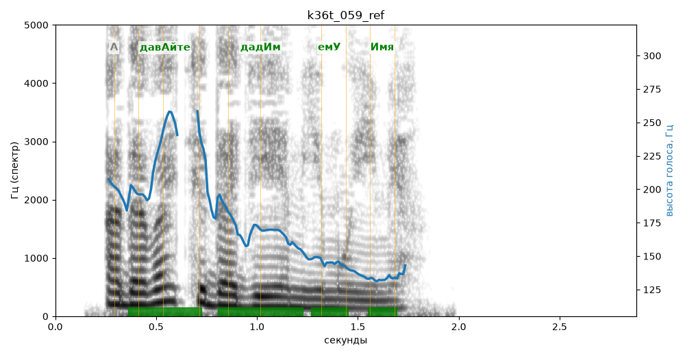

# k36t_059_ref

Голос: **edge:ru-RU-SvetlanaNeural** · длительность 2.9 с
Эталон: А давайте дади́м ему́ имя.
Распознано: А давайте дадем ему имя.
Расхождения в словах: «дади м» → «дадем»

## Ударения
(где нужно: ruaccent)

| слово | нужно | у голоса | |
|---|---|---|---|
| давайте | давАйте | давАйте | ✓ |
| дадим | дадИм | дадИм | ✓ |
| ему | емУ | емУ | ✓ |
| имя | Имя | Имя | ✓ |

## Интонация
- ✓ «а давайте дадим ему имя.» — конец фразы понижается — звучит законченно
- Диапазон голоса 10.5 полутонов (живо), средняя высота 169 Гц

## Паузы и темп
- паузы на своих местах
- Темп 7.1 слога/с (быстро)

_Синяя линия — высота голоса. Над словами заглавная буква — где ударение должно быть; красным — голос поставил не туда (уверенно), оранжевым — возможно._
