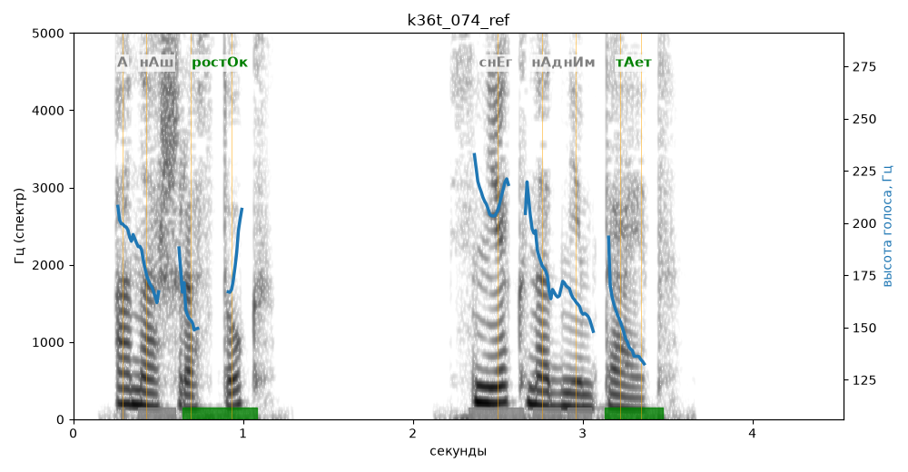

# k36t_074_ref

Голос: **edge:ru-RU-SvetlanaNeural** · длительность 4.5 с
Эталон: А наш росток? Снег над ним тает!
Распознано: А наш росток? Снег над ним тает.
Слова: все совпали

## Ударения
(где нужно: ruaccent)

| слово | нужно | у голоса | |
|---|---|---|---|
| росток | ростОк | ростОк | ✓ |
| тает | тАет | тАет | ✓ |

## Интонация
- ✗ «а наш росток?» — нет вопросительного подъёма (самое высокое место — «а», в начале) — звучит как утверждение
- ✓ «снег над ним тает!» — выделено слово «снег» (+4.5 пт)
- Диапазон голоса 8.0 полутонов (живо), средняя высота 171 Гц

## Паузы и темп
- паузы на своих местах
- Темп 4.6 слога/с (нормально)

_Синяя линия — высота голоса. Над словами заглавная буква — где ударение должно быть; красным — голос поставил не туда (уверенно), оранжевым — возможно._
