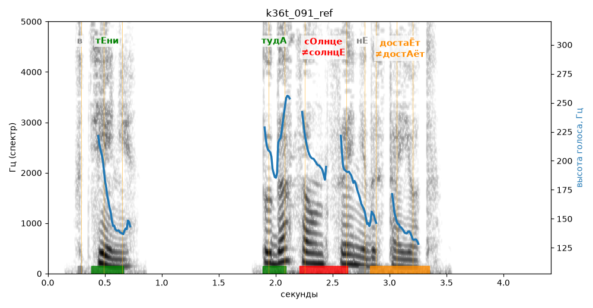

# k36t_091_ref

Голос: **edge:ru-RU-SvetlanaNeural** · длительность 4.4 с
Эталон: В те́ни. Туда со́лнце не достаёт.
Распознано: в тени. туда саунцей не достает.
Расхождения в словах: «те ни» → «тени»; «со лнце» → «саунцей»

## Ударения
(где нужно: ruaccent)

| слово | нужно | у голоса | |
|---|---|---|---|
| тени | тЕни | тЕни | ✓ |
| туда | тудА | тудА | ✓ |
| солнце | сОлнце | солнцЕ | ✗ ОШИБКА |
| достаёт | достаЁт | достАёт | ✗? возможно — послушать |

## Интонация
- ✓ «туда солнце не достаёт.» — конец фразы понижается — звучит законченно
- Диапазон голоса 9.6 полутонов (живо), средняя высота 181 Гц

## Паузы и темп
- паузы на своих местах
- Темп 5.9 слога/с (нормально)

_Синяя линия — высота голоса. Над словами заглавная буква — где ударение должно быть; красным — голос поставил не туда (уверенно), оранжевым — возможно._
