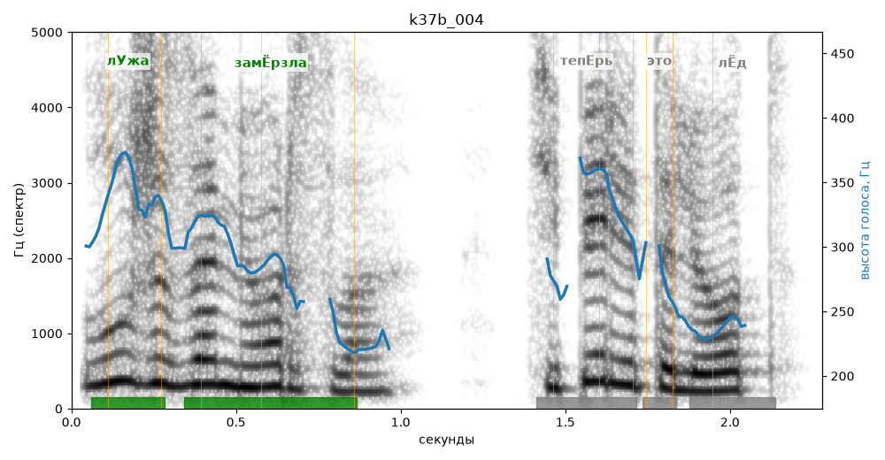

# k37b_004

Голос: **Барсик, сборка 37f** · длительность 2.3 с
Эталон: Лужа замёрзла! Теперь это лёд!
Распознано: Лужи замёрзло. Теперь это лёт.
Расхождения в словах: «лужа замерзла» → «лужи замерзло»; «лед» → «лет»

## Ударения
(где нужно: ruaccent)

| слово | нужно | у голоса | |
|---|---|---|---|
| лужа | лУжа | лУжа | ✓ |
| замёрзла | замЁрзла | замЁрзла | ✓ |
| теперь | тепЕрь | — | ? |
| это | это | этО | нет эталона |

## Интонация
- ✗ «лужа замёрзла!» — восклицание звучит ровно, без эмоции
- ✓ «теперь это лёд!» — выделено слово «теперь» (+3.9 пт)
- Диапазон голоса 8.4 полутонов (живо), средняя высота 291 Гц

## Паузы и темп
- паузы на своих местах
- Темп 7.2 слога/с (быстро)

_Синяя линия — высота голоса. Над словами заглавная буква — где ударение должно быть; красным — голос поставил не туда (уверенно), оранжевым — возможно._
