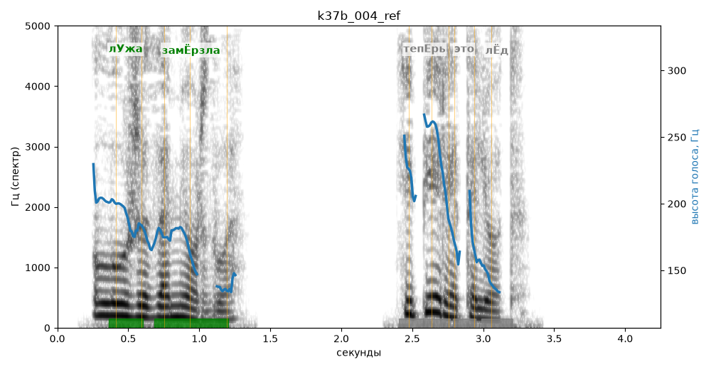

# k37b_004_ref

Голос: **edge:ru-RU-SvetlanaNeural** · длительность 4.2 с
Эталон: Лужа замёрзла! Теперь это лёд!
Распознано: Лужа замерзла. Теперь это лёт.
Расхождения в словах: «лед» → «лет»

## Ударения
(где нужно: ruaccent)

| слово | нужно | у голоса | |
|---|---|---|---|
| лужа | лУжа | лУжа | ✓ |
| замёрзла | замЁрзла | замЁрзла | ✓ |
| теперь | тепЕрь | — | ? |
| это | это | Это | нет эталона |

## Интонация
- ✓ «лужа замёрзла!» — выделено слово «лужа» (+2.3 пт)
- ✓ «теперь это лёд!» — выделено слово «теперь» (+5.9 пт)
- Диапазон голоса 11.1 полутонов (живо), средняя высота 180 Гц

## Паузы и темп
- паузы на своих местах
- Темп 6.7 слога/с (быстро)

_Синяя линия — высота голоса. Над словами заглавная буква — где ударение должно быть; красным — голос поставил не туда (уверенно), оранжевым — возможно._
