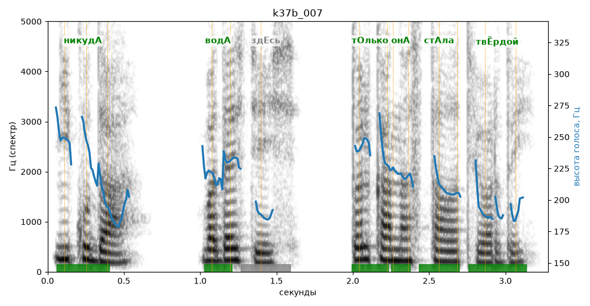

# k37b_007

Голос: **Барсик, сборка 37f** · длительность 3.3 с
Эталон: Никуда. Вода здесь. Только она стала твёрдой.
Распознано: Никуда, вода здесь, только настало твердый.
Расхождения в словах: «она стала твердой» → «настало твердый»

## Ударения
(где нужно: ruaccent)

| слово | нужно | у голоса | |
|---|---|---|---|
| никуда | никудА | никудА | ✓ |
| вода | водА | водА | ✓ |
| только | тОлько | тОлько | ✓ |
| она | онА | онА | ✓ |
| стала | стАла | стАла | ✓ |
| твёрдой | твЁрдой | твЁрдой | ✓ |

## Интонация
- ✓ «никуда.» — конец фразы понижается — звучит законченно
- ✓ «вода здесь.» — конец фразы понижается — звучит законченно
- ✓ «только она стала твёрдой.» — конец фразы понижается — звучит законченно
- Диапазон голоса 5.3 полутонов (нормально), средняя высота 217 Гц

## Паузы и темп
- паузы на своих местах
- Темп 6.8 слога/с (быстро)

_Синяя линия — высота голоса. Над словами заглавная буква — где ударение должно быть; красным — голос поставил не туда (уверенно), оранжевым — возможно._
