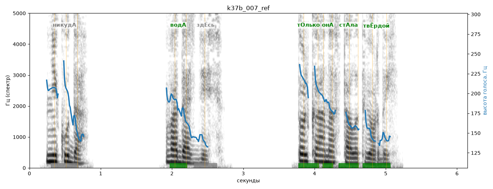

# k37b_007_ref

Голос: **edge:ru-RU-SvetlanaNeural** · длительность 6.1 с
Эталон: Никуда. Вода здесь. Только она стала твёрдой.
Распознано: Никуда. Вода здесь. Только она стала твердой.
Слова: все совпали

## Ударения
(где нужно: ruaccent)

| слово | нужно | у голоса | |
|---|---|---|---|
| никуда | никудА | нИкуда | ? не разобрать |
| вода | водА | водА | ✓ |
| только | тОлько | тОлько | ✓ |
| она | онА | онА | ✓ |
| стала | стАла | стАла | ✓ |
| твёрдой | твЁрдой | твЁрдой | ✓ |

## Интонация
- ✓ «никуда.» — конец фразы понижается — звучит законченно
- ✓ «вода здесь.» — конец фразы понижается — звучит законченно
- ✓ «только она стала твёрдой.» — конец фразы понижается — звучит законченно
- Диапазон голоса 7.7 полутонов (живо), средняя высота 172 Гц

## Паузы и темп
- паузы на своих местах
- Темп 6.0 слога/с (нормально)

_Синяя линия — высота голоса. Над словами заглавная буква — где ударение должно быть; красным — голос поставил не туда (уверенно), оранжевым — возможно._
