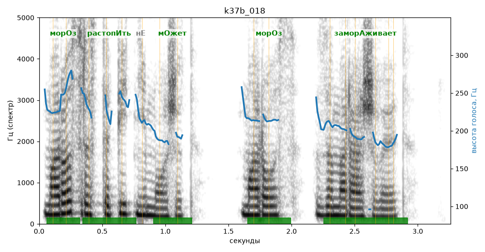

# k37b_018

Голос: **Барсик, сборка 37f** · длительность 3.3 с
Эталон: Мороз растопить не может. Мороз — замораживает.
Распознано: Мороз растопит не может, Мороз замораживает.
Расхождения в словах: «растопить» → «растопит»

## Ударения
(где нужно: ruaccent)

| слово | нужно | у голоса | |
|---|---|---|---|
| мороз | морОз | морОз | ✓ |
| растопить | растопИть | растопИть | ✓ |
| может | мОжет | мОжет | ✓ |
| мороз | морОз | морОз | ✓ |
| замораживает | заморАживает | заморАживает | ✓ |

## Интонация
- ✓ «мороз растопить не может.» — конец фразы понижается — звучит законченно
- ✓ «мороз замораживает.» — конец фразы понижается — звучит законченно
- Диапазон голоса 5.9 полутонов (нормально), средняя высота 213 Гц

## Паузы и темп
- паузы на своих местах
- Темп 7.4 слога/с (быстро)

_Синяя линия — высота голоса. Над словами заглавная буква — где ударение должно быть; красным — голос поставил не туда (уверенно), оранжевым — возможно._
