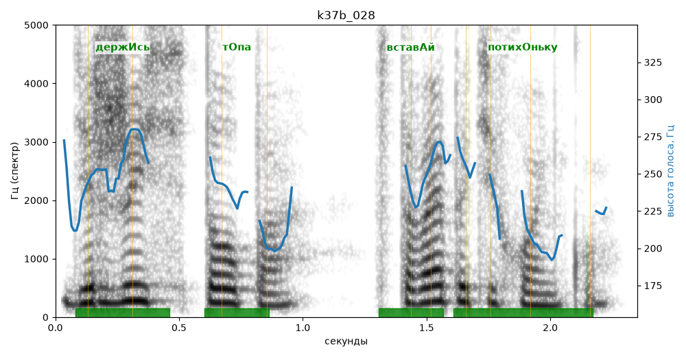

# k37b_028

Голос: **Барсик, сборка 37f** · длительность 2.4 с
Эталон: Держись, Топа! Вставай потихоньку.
Распознано: держись топа, вставай потихоньку.
Слова: все совпали

## Ударения
(где нужно: ruaccent)

| слово | нужно | у голоса | |
|---|---|---|---|
| держись | держИсь | держИсь | ✓ |
| топа | тОпа | тОпа | ✓ |
| вставай | вставАй | вставАй | ✓ |
| потихоньку | потихОньку | потихОньку | ✓ |

## Интонация
- ✗ «держись топа!» — восклицание звучит ровно, без эмоции
- ✓ «вставай потихоньку.» — конец фразы понижается — звучит законченно
- Диапазон голоса 5.6 полутонов (нормально), средняя высота 238 Гц

## Паузы и темп
- паузы на своих местах
- Темп 6.1 слога/с (нормально)

_Синяя линия — высота голоса. Над словами заглавная буква — где ударение должно быть; красным — голос поставил не туда (уверенно), оранжевым — возможно._
