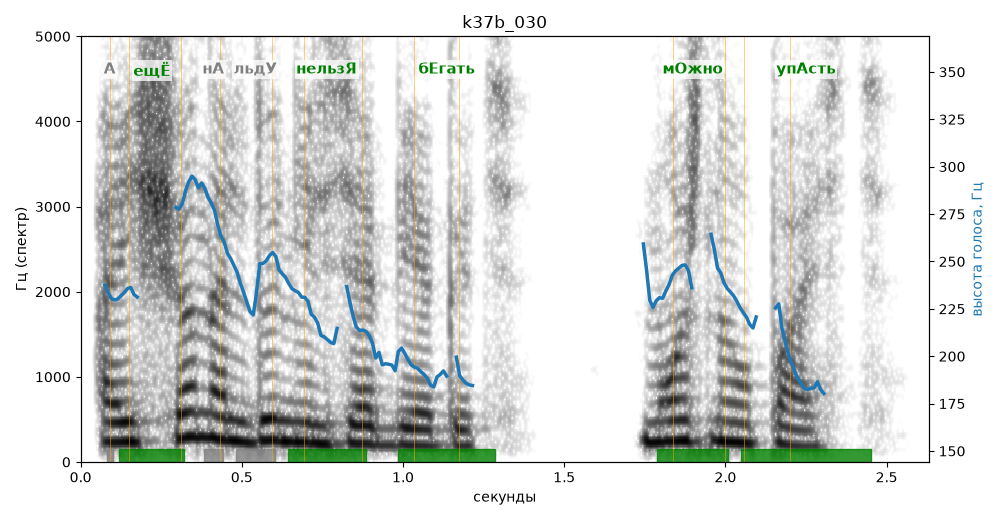

# k37b_030

Голос: **Барсик, сборка 37f** · длительность 2.6 с
Эталон: А ещё на льду нельзя бегать. Можно упасть.
Распознано: А еще на леду нельзя бегать. Можно упасть.
Расхождения в словах: «льду» → «леду»

## Ударения
(где нужно: ruaccent)

| слово | нужно | у голоса | |
|---|---|---|---|
| ещё | ещЁ | ещЁ | ✓ |
| нельзя | нельзЯ | нельзЯ | ✓ |
| бегать | бЕгать | бЕгать | ✓ |
| можно | мОжно | мОжно | ✓ |
| упасть | упАсть | упАсть | ✓ |

## Интонация
- ✓ «а ещё на льду нельзя бегать.» — конец фразы понижается — звучит законченно
- ✓ «можно упасть.» — конец фразы понижается — звучит законченно
- Диапазон голоса 7.4 полутонов (живо), средняя высота 229 Гц

## Паузы и темп
- паузы на своих местах
- Темп 7.0 слога/с (быстро)

_Синяя линия — высота голоса. Над словами заглавная буква — где ударение должно быть; красным — голос поставил не туда (уверенно), оранжевым — возможно._
