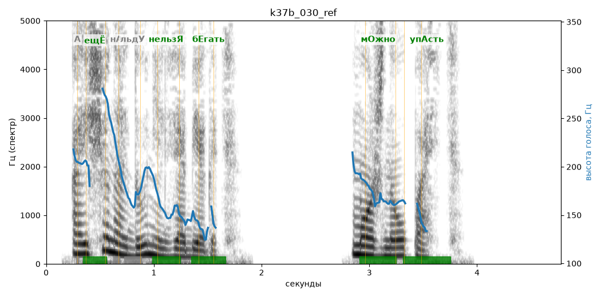

# k37b_030_ref

Голос: **edge:ru-RU-SvetlanaNeural** · длительность 4.8 с
Эталон: А ещё на льду нельзя бегать. Можно упасть.
Распознано: А еще на льду нельзя бегать. Можно упасть.
Слова: все совпали

## Ударения
(где нужно: ruaccent)

| слово | нужно | у голоса | |
|---|---|---|---|
| ещё | ещЁ | ещЁ | ✓ |
| нельзя | нельзЯ | нельзЯ | ✓ |
| бегать | бЕгать | бЕгать | ✓ |
| можно | мОжно | мОжно | ✓ |
| упасть | упАсть | упАсть | ✓ |

## Интонация
- ✓ «а ещё на льду нельзя бегать.» — конец фразы понижается — звучит законченно
- ✓ «можно упасть.» — конец фразы понижается — звучит законченно
- Диапазон голоса 9.8 полутонов (живо), средняя высота 165 Гц

## Паузы и темп
- паузы на своих местах
- Темп 5.8 слога/с (нормально)

_Синяя линия — высота голоса. Над словами заглавная буква — где ударение должно быть; красным — голос поставил не туда (уверенно), оранжевым — возможно._
