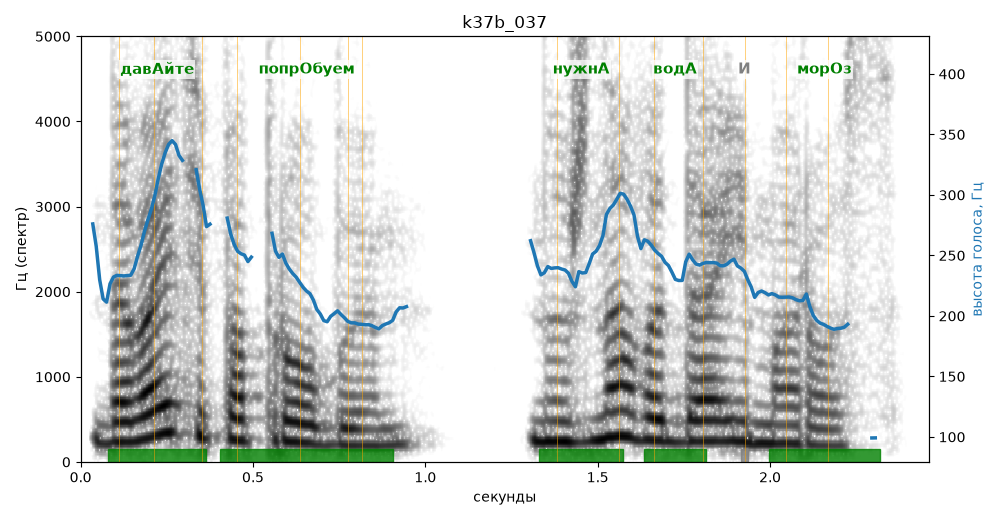

# k37b_037

Голос: **Барсик, сборка 37f** · длительность 2.5 с
Эталон: Давайте попробуем! Нужна вода и мороз.
Распознано: Давайте попробуем нужна вода и мороз.
Слова: все совпали

## Ударения
(где нужно: ruaccent)

| слово | нужно | у голоса | |
|---|---|---|---|
| давайте | давАйте | давАйте | ✓ |
| попробуем | попрОбуем | попрОбуем | ✓ |
| нужна | нужнА | нужнА | ✓ |
| вода | водА | водА | ✓ |
| мороз | морОз | морОз | ✓ |

## Интонация
- ✓ «давайте попробуем!» — выделено слово «давайте» (+4.7 пт)
- ✓ «нужна вода и мороз.» — конец фразы понижается — звучит законченно
- Диапазон голоса 8.2 полутонов (живо), средняя высота 237 Гц

## Паузы и темп
- паузы на своих местах
- Темп 7.7 слога/с (быстро)

_Синяя линия — высота голоса. Над словами заглавная буква — где ударение должно быть; красным — голос поставил не туда (уверенно), оранжевым — возможно._
