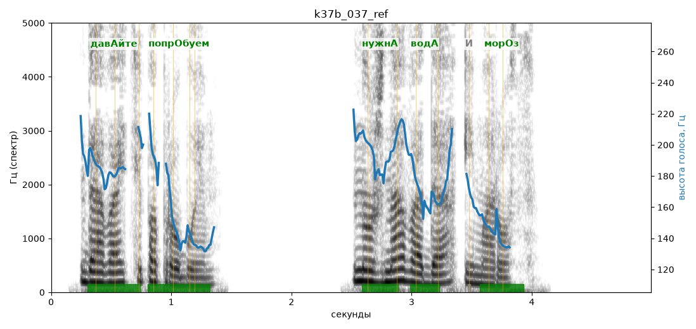

# k37b_037_ref

Голос: **edge:ru-RU-SvetlanaNeural** · длительность 5.0 с
Эталон: Давайте попробуем! Нужна вода и мороз.
Распознано: Давайте попробуем. Нужна вода и мороз.
Слова: все совпали

## Ударения
(где нужно: ruaccent)

| слово | нужно | у голоса | |
|---|---|---|---|
| давайте | давАйте | давАйте | ✓ |
| попробуем | попрОбуем | попрОбуем | ✓ |
| нужна | нужнА | нужнА | ✓ |
| вода | водА | водА | ✓ |
| мороз | морОз | морОз | ✓ |

## Интонация
- ✗ «давайте попробуем!» — восклицание звучит ровно, без эмоции
- ✓ «нужна вода и мороз.» — конец фразы понижается — звучит законченно
- Диапазон голоса 7.7 полутонов (живо), средняя высота 178 Гц

## Паузы и темп
- паузы на своих местах
- Темп 6.6 слога/с (быстро)

_Синяя линия — высота голоса. Над словами заглавная буква — где ударение должно быть; красным — голос поставил не туда (уверенно), оранжевым — возможно._
