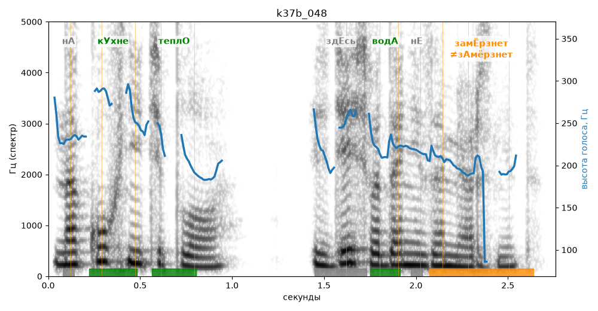

# k37b_048

Голос: **Барсик, сборка 37f** · длительность 2.8 с
Эталон: На кухне тепло. Здесь вода не замёрзнет.
Распознано: На кухне тепло. Здесь вода не замерзнет.
Слова: все совпали

## Ударения
(где нужно: ruaccent)

| слово | нужно | у голоса | |
|---|---|---|---|
| кухне | кУхне | кУхне | ✓ |
| тепло | теплО | теплО | ✓ |
| вода | водА | водА | ✓ |
| замёрзнет | замЁрзнет | зАмёрзнет | ✗? возможно — послушать |

## Интонация
- ✓ «на кухне тепло.» — конец фразы понижается — звучит законченно
- ✓ «здесь вода не замёрзнет.» — конец фразы понижается — звучит законченно
- Диапазон голоса 7.6 полутонов (живо), средняя высота 219 Гц

## Паузы и темп
- паузы на своих местах
- Темп 6.3 слога/с (нормально)

_Синяя линия — высота голоса. Над словами заглавная буква — где ударение должно быть; красным — голос поставил не туда (уверенно), оранжевым — возможно._
