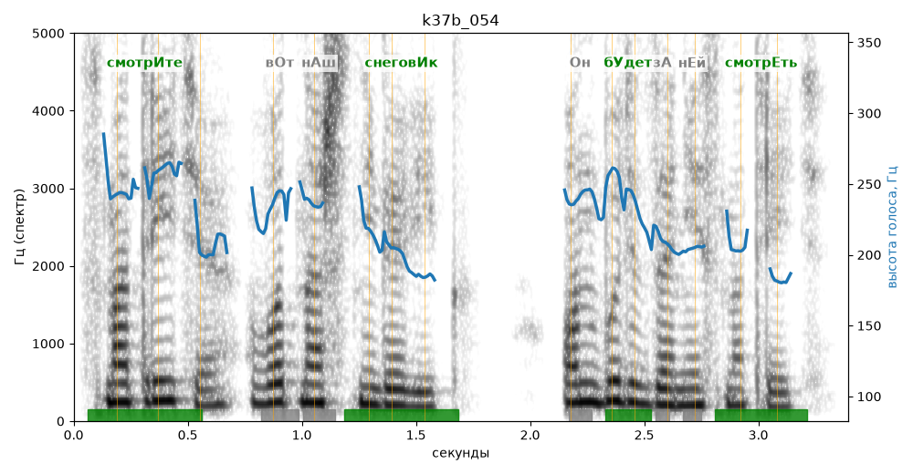

# k37b_054

Голос: **Барсик, сборка 37f** · длительность 3.4 с
Эталон: Смотрите, вот наш снеговик. Он будет за ней смотреть.
Распознано: Смотрите, вот наш снеговик. Он будет за ней смотреть.
Слова: все совпали

## Ударения
(где нужно: ruaccent)

| слово | нужно | у голоса | |
|---|---|---|---|
| смотрите | смотрИте | смотрИте | ✓ |
| снеговик | снеговИк | снеговИк | ✓ |
| будет | бУдет | бУдет | ✓ |
| смотреть | смотрЕть | смотрЕть | ✓ |

## Интонация
- ✓ «смотрите вот наш снеговик.» — конец фразы понижается — звучит законченно
- ✓ «он будет за ней смотреть.» — конец фразы понижается — звучит законченно
- Диапазон голоса 6.1 полутонов (нормально), средняя высота 223 Гц

## Паузы и темп
- паузы на своих местах
- Темп 6.2 слога/с (нормально)

_Синяя линия — высота голоса. Над словами заглавная буква — где ударение должно быть; красным — голос поставил не туда (уверенно), оранжевым — возможно._
