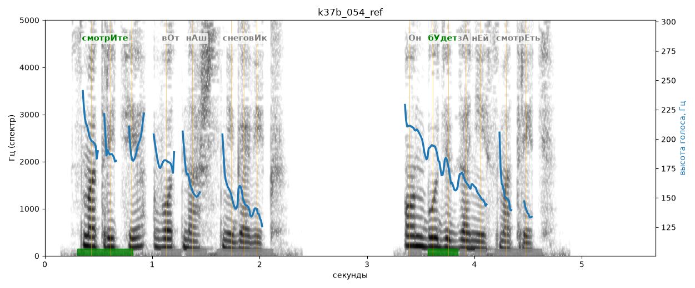

# k37b_054_ref

Голос: **edge:ru-RU-SvetlanaNeural** · длительность 5.7 с
Эталон: Смотри́те, вот наш снеговик. Он будет за ней смотреть.
Распознано: Смотрите, вот наш снеговик. Он будет за ней смотреть.
Расхождения в словах: «смотри те» → «смотрите»

## Ударения
(где нужно: ruaccent)

| слово | нужно | у голоса | |
|---|---|---|---|
| смотрите | смотрИте | смотрИте | ✓ |
| снеговик | снеговИк | снЕговик | ? не разобрать |
| будет | бУдет | бУдет | ✓ |
| смотреть | смотрЕть | смОтреть | ? не разобрать |

## Интонация
- ✓ «смотрите вот наш снеговик.» — конец фразы понижается — звучит законченно
- ✓ «он будет за ней смотреть.» — конец фразы понижается — звучит законченно
- Диапазон голоса 7.6 полутонов (живо), средняя высота 174 Гц

## Паузы и темп
- паузы на своих местах
- Темп 5.3 слога/с (нормально)

_Синяя линия — высота голоса. Над словами заглавная буква — где ударение должно быть; красным — голос поставил не туда (уверенно), оранжевым — возможно._
