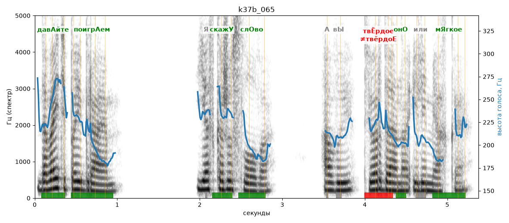

# k37b_065

Голос: **Барсик, сборка 37f** · длительность 5.4 с
Эталон: Давайте поиграем. Я скажу слово, а вы — твёрдое оно или мягкое.
Распознано: Давайте поиграем. Я скажу слово, а вы твердое оно или мягкое.
Слова: все совпали

## Ударения
(где нужно: ruaccent)

| слово | нужно | у голоса | |
|---|---|---|---|
| давайте | давАйте | давАйте | ✓ |
| поиграем | поигрАем | поигрАем | ✓ |
| скажу | скажУ | скажУ | ✓ |
| слово | слОво | слОво | ✓ |
| твёрдое | твЁрдое | твёрдоЕ | ✗ ОШИБКА |
| оно | онО | онО | ✓ |
| или | или | илИ | нет эталона |
| мягкое | мЯгкое | мЯгкое | ✓ |

## Интонация
- ✓ «давайте поиграем.» — конец фразы понижается — звучит законченно
- ✓ «я скажу слово а вы твёрдое оно или мягкое.» — конец фразы понижается — звучит законченно
- Диапазон голоса 6.0 полутонов (нормально), средняя высота 213 Гц

## Паузы и темп
- паузы на своих местах
- Темп 7.7 слога/с (быстро)

_Синяя линия — высота голоса. Над словами заглавная буква — где ударение должно быть; красным — голос поставил не туда (уверенно), оранжевым — возможно._
