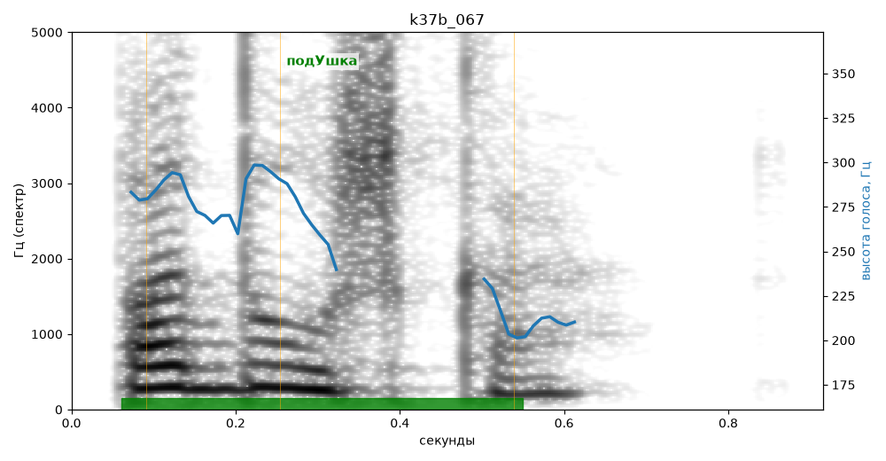

# k37b_067

Голос: **Барсик, сборка 37f** · длительность 0.9 с
Эталон: Подушка!
Распознано: Подушка
Слова: все совпали

## Ударения
(где нужно: ruaccent)

| слово | нужно | у голоса | |
|---|---|---|---|
| подушка | подУшка | подУшка | ✓ |

## Интонация
- ✗ «подушка!» — восклицание звучит ровно, без эмоции
- Диапазон голоса 6.5 полутонов (нормально), средняя высота 270 Гц

## Паузы и темп
- паузы на своих местах
- Темп 6.1 слога/с (нормально)

_Синяя линия — высота голоса. Над словами заглавная буква — где ударение должно быть; красным — голос поставил не туда (уверенно), оранжевым — возможно._
