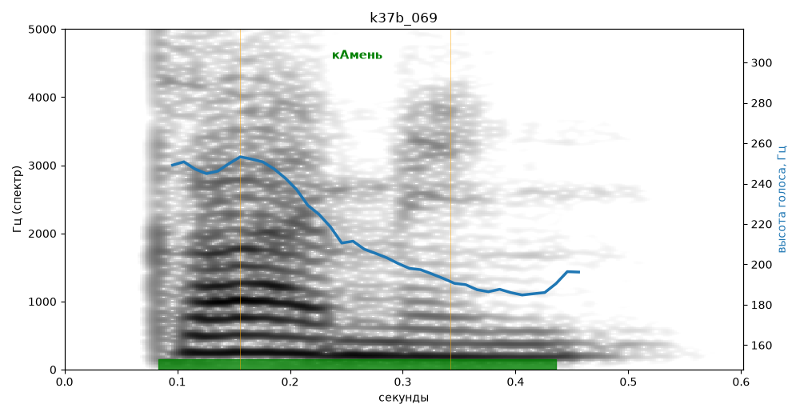

# k37b_069

Голос: **Барсик, сборка 37f** · длительность 0.6 с
Эталон: Камень!
Распознано: Камень!
Слова: все совпали

## Ударения
(где нужно: ruaccent)

| слово | нужно | у голоса | |
|---|---|---|---|
| камень | кАмень | кАмень | ✓ |

## Интонация
- Диапазон голоса 5.2 полутонов (нормально), средняя высота 205 Гц

## Паузы и темп
- паузы на своих местах
- Темп 5.7 слога/с (нормально)

_Синяя линия — высота голоса. Над словами заглавная буква — где ударение должно быть; красным — голос поставил не туда (уверенно), оранжевым — возможно._
