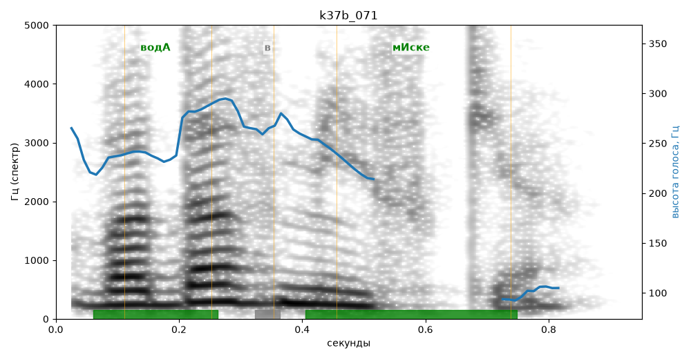

# k37b_071

Голос: **Барсик, сборка 37f** · длительность 1.0 с
Эталон: Вода в миске!
Распознано: Вада в миске.
Расхождения в словах: «вода» → «вада»

## Ударения
(где нужно: ruaccent)

| слово | нужно | у голоса | |
|---|---|---|---|
| вода | водА | водА | ✓ |
| миске | мИске | мИске | ✓ |

## Интонация
- ✓ «вода в миске!» — выделено слово «вода» (+3.1 пт)
- Диапазон голоса 19.2 полутонов (живо), средняя высота 240 Гц

## Паузы и темп
- паузы на своих местах
- Темп 7.3 слога/с (быстро)

_Синяя линия — высота голоса. Над словами заглавная буква — где ударение должно быть; красным — голос поставил не туда (уверенно), оранжевым — возможно._
