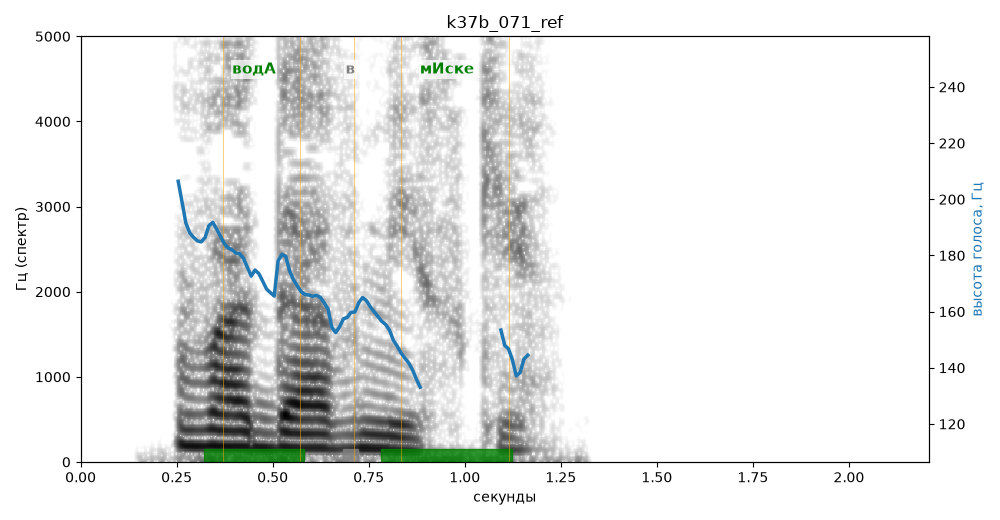

# k37b_071_ref

Голос: **edge:ru-RU-SvetlanaNeural** · длительность 2.2 с
Эталон: Вода в миске!
Распознано: Вада в миске.
Расхождения в словах: «вода» → «вада»

## Ударения
(где нужно: ruaccent)

| слово | нужно | у голоса | |
|---|---|---|---|
| вода | водА | водА | ✓ |
| миске | мИске | мИске | ✓ |

## Интонация
- ✗ «вода в миске!» — восклицание звучит ровно, без эмоции
- Диапазон голоса 5.5 полутонов (нормально), средняя высота 166 Гц

## Паузы и темп
- паузы на своих местах
- Темп 6.2 слога/с (нормально)

_Синяя линия — высота голоса. Над словами заглавная буква — где ударение должно быть; красным — голос поставил не туда (уверенно), оранжевым — возможно._
