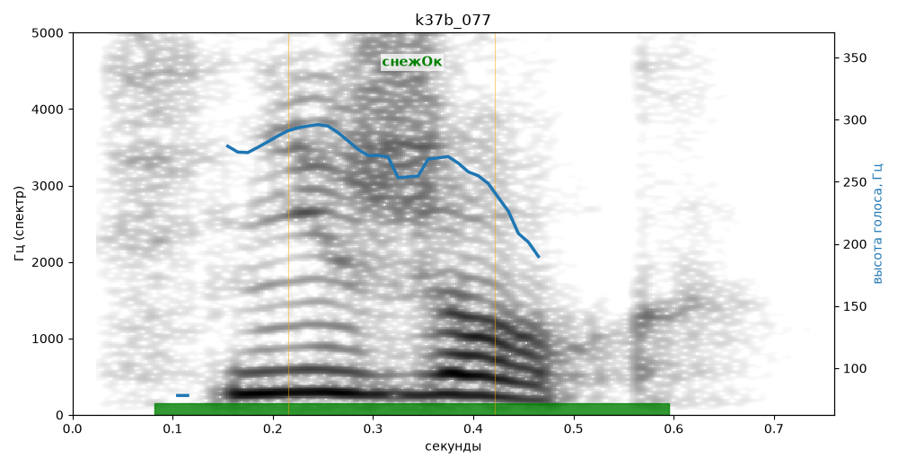

# k37b_077

Голос: **Барсик, сборка 37f** · длительность 0.8 с
Эталон: Снежок!
Распознано: Снижок.
Расхождения в словах: «снежок» → «снижок»

## Ударения
(где нужно: ruaccent)

| слово | нужно | у голоса | |
|---|---|---|---|
| снежок | снежОк | снежОк | ✓ |

## Интонация
- Диапазон голоса 13.0 полутонов (живо), средняя высота 270 Гц

## Паузы и темп
- паузы на своих местах
- Темп 3.9 слога/с (медленно)

_Синяя линия — высота голоса. Над словами заглавная буква — где ударение должно быть; красным — голос поставил не туда (уверенно), оранжевым — возможно._
