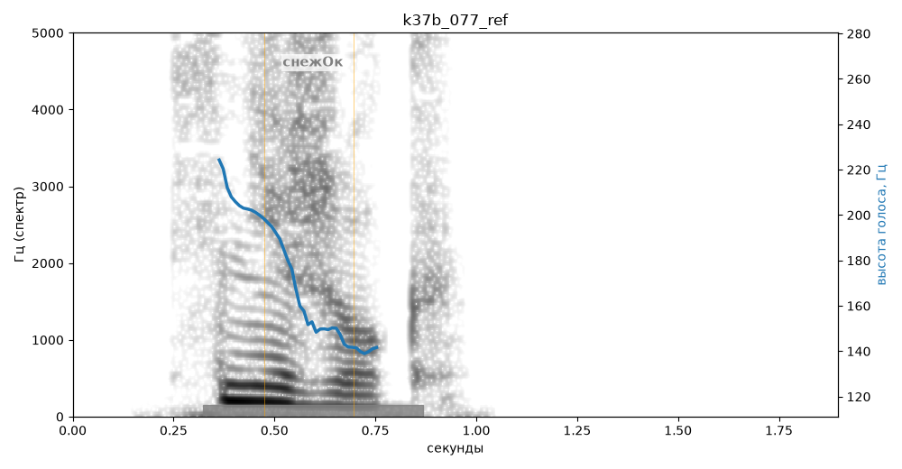

# k37b_077_ref

Голос: **edge:ru-RU-SvetlanaNeural** · длительность 1.9 с
Эталон: Снежок!
Распознано: Снежок
Слова: все совпали

## Ударения
(где нужно: ruaccent)

| слово | нужно | у голоса | |
|---|---|---|---|
| снежок | снежОк | снЕжок | ? не разобрать |

## Интонация
- Диапазон голоса 7.2 полутонов (живо), средняя высота 164 Гц

## Паузы и темп
- паузы на своих местах
- Темп 3.7 слога/с (медленно)

_Синяя линия — высота голоса. Над словами заглавная буква — где ударение должно быть; красным — голос поставил не туда (уверенно), оранжевым — возможно._
