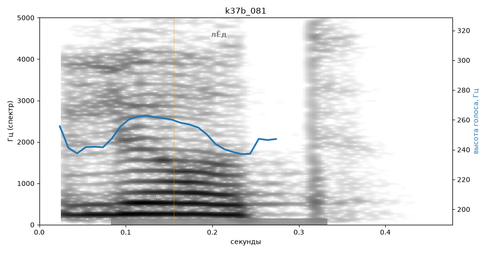

# k37b_081

Голос: **Барсик, сборка 37f** · длительность 0.5 с
Эталон: Лёд!
Распознано: Лет!
Расхождения в словах: «лед» → «лет»

## Ударения
(где нужно: дано в тексте)

| слово | нужно | у голоса | |
|---|---|---|---|

## Интонация
- Диапазон голоса 1.7 полутонов (монотонно, как робот), средняя высота 247 Гц

## Паузы и темп
- паузы на своих местах
- Темп 4.0 слога/с (нормально)

_Синяя линия — высота голоса. Над словами заглавная буква — где ударение должно быть; красным — голос поставил не туда (уверенно), оранжевым — возможно._
