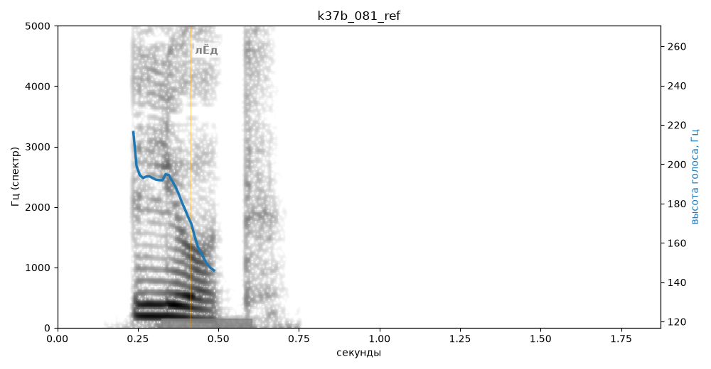

# k37b_081_ref

Голос: **edge:ru-RU-SvetlanaNeural** · длительность 1.9 с
Эталон: Лёд!
Распознано: Лет
Расхождения в словах: «лед» → «лет»

## Ударения
(где нужно: дано в тексте)

| слово | нужно | у голоса | |
|---|---|---|---|

## Интонация
- Диапазон голоса 5.1 полутонов (нормально), средняя высота 190 Гц

## Паузы и темп
- паузы на своих местах
- Темп 3.5 слога/с (медленно)

_Синяя линия — высота голоса. Над словами заглавная буква — где ударение должно быть; красным — голос поставил не туда (уверенно), оранжевым — возможно._
