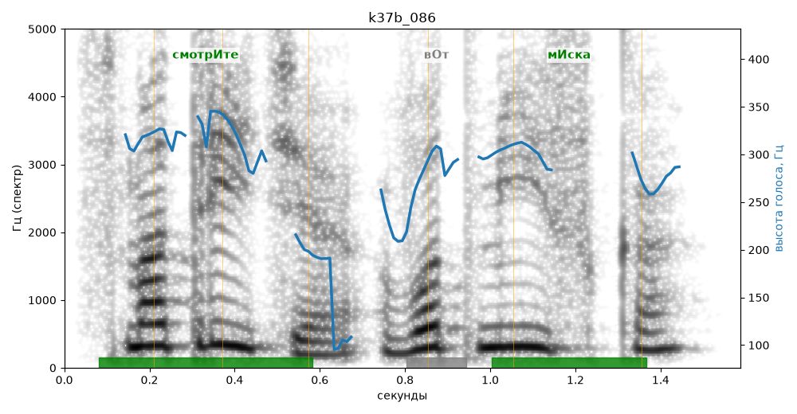

# k37b_086

Голос: **Барсик, сборка 37f** · длительность 1.6 с
Эталон: Смотрите, вот миска!
Распознано: Смотрите, вот миска.
Слова: все совпали

## Ударения
(где нужно: ruaccent)

| слово | нужно | у голоса | |
|---|---|---|---|
| смотрите | смотрИте | смотрИте | ✓ |
| миска | мИска | мИска | ✓ |

## Интонация
- ✓ «смотрите вот миска!» — выделено слово «смотрите» (+2.1 пт)
- Диапазон голоса 12.8 полутонов (живо), средняя высота 295 Гц

## Паузы и темп
- паузы на своих местах
- Темп 5.6 слога/с (нормально)

_Синяя линия — высота голоса. Над словами заглавная буква — где ударение должно быть; красным — голос поставил не туда (уверенно), оранжевым — возможно._
