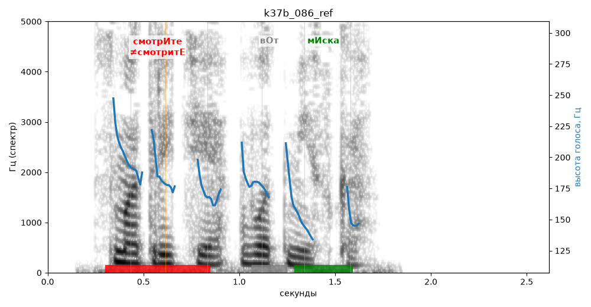

# k37b_086_ref

Голос: **edge:ru-RU-SvetlanaNeural** · длительность 2.6 с
Эталон: Смотри́те, вот миска!
Распознано: Смотрите, вот миска.
Расхождения в словах: «смотри те» → «смотрите»

## Ударения
(где нужно: ruaccent)

| слово | нужно | у голоса | |
|---|---|---|---|
| смотрите | смотрИте | смотритЕ | ✗ ОШИБКА |
| миска | мИска | мИска | ✓ |

## Интонация
- ✗ «смотрите вот миска!» — восклицание звучит ровно, без эмоции
- Диапазон голоса 7.0 полутонов (живо), средняя высота 178 Гц

## Паузы и темп
- паузы на своих местах
- Темп 5.6 слога/с (нормально)

_Синяя линия — высота голоса. Над словами заглавная буква — где ударение должно быть; красным — голос поставил не туда (уверенно), оранжевым — возможно._
