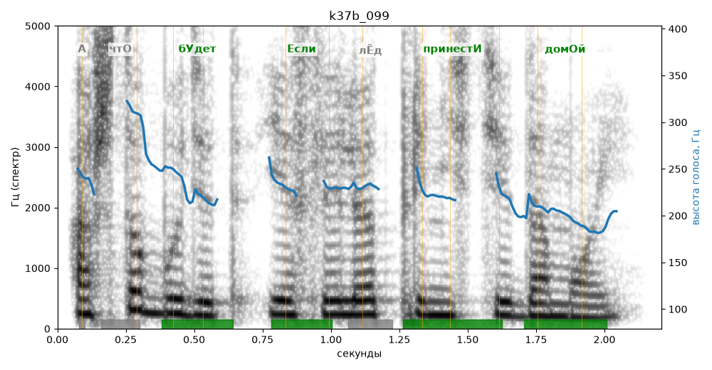

# k37b_099

Голос: **Барсик, сборка 37f** · длительность 2.2 с
Эталон: А что будет, если лёд принести домой?
Распознано: А что будет, если лед принести домой?
Слова: все совпали

## Ударения
(где нужно: ruaccent)

| слово | нужно | у голоса | |
|---|---|---|---|
| будет | бУдет | бУдет | ✓ |
| если | Если | Если | ✓ |
| принести | принестИ | принестИ | ✓ |
| домой | домОй | домОй | ✓ |

## Интонация
- ✓ «а что будет если лёд принести домой?» — вопросительный подъём на слове «что»
- Диапазон голоса 6.9 полутонов (нормально), средняя высота 223 Гц

## Паузы и темп
- паузы на своих местах
- Темп 6.2 слога/с (нормально)

_Синяя линия — высота голоса. Над словами заглавная буква — где ударение должно быть; красным — голос поставил не туда (уверенно), оранжевым — возможно._
