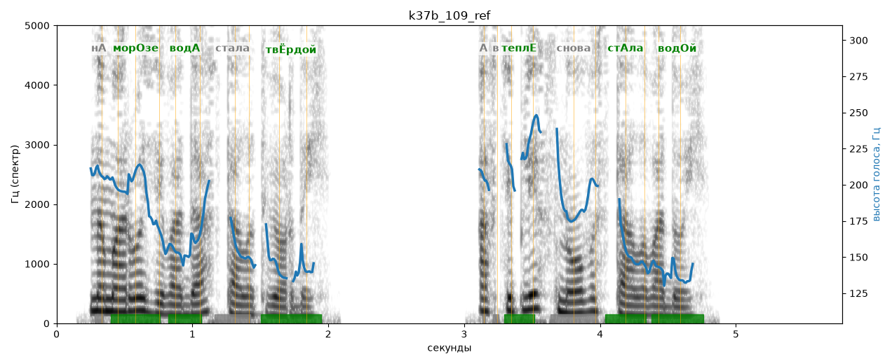

# k37b_109_ref

Голос: **edge:ru-RU-SvetlanaNeural** · длительность 5.8 с
Эталон: На морозе вода стала твёрдой. А в тепле снова стала водой.
Распознано: На морозе вода стало твердой. А в тепле снова стало водой.
Расхождения в словах: «стала» → «стало»; «стала» → «стало»

## Ударения
(где нужно: ruaccent)

| слово | нужно | у голоса | |
|---|---|---|---|
| морозе | морОзе | морОзе | ✓ |
| вода | водА | водА | ✓ |
| стала | стала | стАла | нет эталона |
| твёрдой | твЁрдой | твЁрдой | ✓ |
| тепле | теплЕ | теплЕ | ✓ |
| снова | снова | снОва | нет эталона |
| стала | стАла | стАла | ✓ |
| водой | водОй | водОй | ✓ |

## Интонация
- ✓ «на морозе вода стала твёрдой.» — конец фразы понижается — звучит законченно
- ✓ «а в тепле снова стала водой.» — конец фразы понижается — звучит законченно
- Диапазон голоса 8.5 полутонов (живо), средняя высота 166 Гц

## Паузы и темп
- паузы на своих местах
- Темп 6.1 слога/с (нормально)

_Синяя линия — высота голоса. Над словами заглавная буква — где ударение должно быть; красным — голос поставил не туда (уверенно), оранжевым — возможно._
