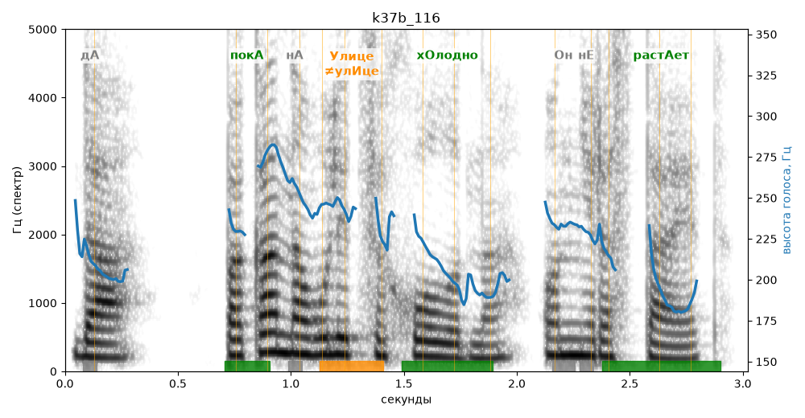

# k37b_116

Голос: **Барсик, сборка 37f** · длительность 3.0 с
Эталон: Да. Пока на улице холодно, он не растает.
Распознано: Да, пока на улице холодно, он не растает.
Слова: все совпали

## Ударения
(где нужно: ruaccent)

| слово | нужно | у голоса | |
|---|---|---|---|
| пока | покА | покА | ✓ |
| улице | Улице | улИце | ✗? возможно — послушать |
| холодно | хОлодно | хОлодно | ✓ |
| растает | растАет | растАет | ✓ |

## Интонация
- ✓ «пока на улице холодно он не растает.» — конец фразы понижается — звучит законченно
- Диапазон голоса 6.6 полутонов (нормально), средняя высота 223 Гц

## Паузы и темп
- паузы на своих местах
- Темп 7.5 слога/с (быстро)

_Синяя линия — высота голоса. Над словами заглавная буква — где ударение должно быть; красным — голос поставил не туда (уверенно), оранжевым — возможно._
