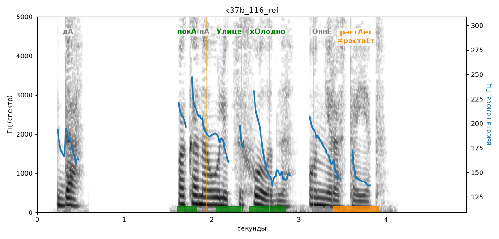

# k37b_116_ref

Голос: **edge:ru-RU-SvetlanaNeural** · длительность 4.9 с
Эталон: Да. Пока на улице холодно, он не раста́ет.
Распознано: Да. Пока на улице холодно, он не растает.
Расхождения в словах: «раста ет» → «растает»

## Ударения
(где нужно: ruaccent)

| слово | нужно | у голоса | |
|---|---|---|---|
| пока | покА | покА | ✓ |
| улице | Улице | Улице | ✓ |
| холодно | хОлодно | хОлодно | ✓ |
| растает | растАет | растаЕт | ✗? возможно — послушать |

## Интонация
- ✓ «пока на улице холодно он не растает.» — конец фразы понижается — звучит законченно
- Диапазон голоса 7.2 полутонов (живо), средняя высота 175 Гц

## Паузы и темп
- паузы на своих местах
- Темп 7.3 слога/с (быстро)

_Синяя линия — высота голоса. Над словами заглавная буква — где ударение должно быть; красным — голос поставил не туда (уверенно), оранжевым — возможно._
