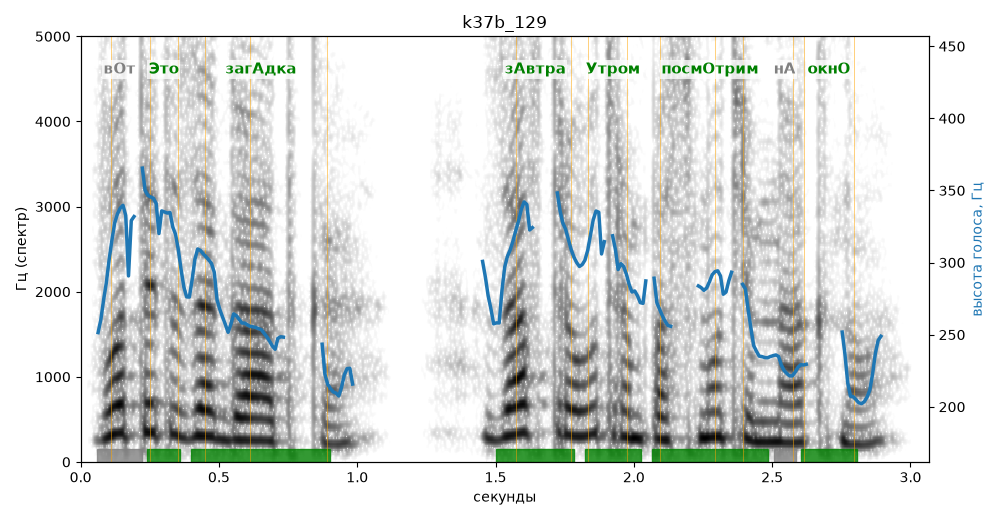

# k37b_129

Голос: **Барсик, сборка 37f** · длительность 3.1 с
Эталон: Вот это загадка! Завтра утром посмотрим на окно.
Распознано: Вот эта загадка. Завтра утром посмотрим на окно.
Расхождения в словах: «это» → «эта»

## Ударения
(где нужно: ruaccent)

| слово | нужно | у голоса | |
|---|---|---|---|
| это | Это | Это | ✓ |
| загадка | загАдка | загАдка | ✓ |
| завтра | зАвтра | зАвтра | ✓ |
| утром | Утром | Утром | ✓ |
| посмотрим | посмОтрим | посмОтрим | ✓ |
| окно | окнО | окнО | ✓ |

## Интонация
- ✓ «вот это загадка!» — выделено слово «это» (+2.1 пт)
- ✓ «завтра утром посмотрим на окно.» — конец фразы понижается — звучит законченно
- Диапазон голоса 8.2 полутонов (живо), средняя высота 278 Гц

## Паузы и темп
- паузы на своих местах
- Темп 7.5 слога/с (быстро)

_Синяя линия — высота голоса. Над словами заглавная буква — где ударение должно быть; красным — голос поставил не туда (уверенно), оранжевым — возможно._
