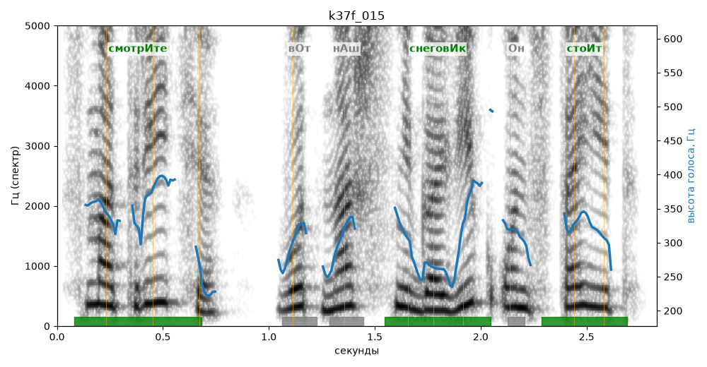

# k37f_015

Голос: **Филя, сборка 37f** · длительность 2.8 с
Эталон: Смотрите, вот наш снеговик! Он стоит!
Распознано: Смотрите, вот наш снеговик он стоит.
Слова: все совпали

## Ударения
(где нужно: ruaccent)

| слово | нужно | у голоса | |
|---|---|---|---|
| смотрите | смотрИте | смотрИте | ✓ |
| снеговик | снеговИк | снеговИк | ✓ |
| стоит | стоИт | стоИт | ✓ |

## Интонация
- ✓ «смотрите вот наш снеговик!» — выделено слово «смотрите» (+4.0 пт)
- ✗ «он стоит!» — восклицание звучит ровно, без эмоции
- Диапазон голоса 8.7 полутонов (живо), средняя высота 320 Гц

## Паузы и темп
- после «снеговик!» пауза всего 0.08 с — фразы слипаются
- Темп 4.9 слога/с (нормально)

_Синяя линия — высота голоса. Над словами заглавная буква — где ударение должно быть; красным — голос поставил не туда (уверенно), оранжевым — возможно._
