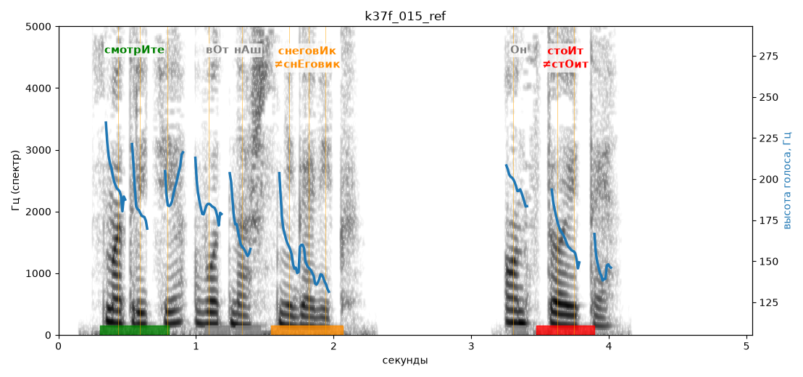

# k37f_015_ref

Голос: **edge:ru-RU-SvetlanaNeural** · длительность 5.0 с
Эталон: Смотри́те, вот наш снеговик! Он стои́т!
Распознано: Смотрите, вот наш снеговик. Он стоит ты.
Расхождения в словах: «смотри те» → «смотрите»; «стои т» → «стоит ты»

## Ударения
(где нужно: ruaccent)

| слово | нужно | у голоса | |
|---|---|---|---|
| смотрите | смотрИте | смотрИте | ✓ |
| снеговик | снеговИк | снЕговик | ✗? возможно — послушать |
| стоит | стоИт | стОит | ✗ ОШИБКА |

## Интонация
- ✗ «смотрите вот наш снеговик!» — восклицание звучит ровно, без эмоции
- ✓ «он стоит!» — выделено слово «он» (+2.1 пт)
- Диапазон голоса 7.1 полутонов (живо), средняя высота 177 Гц

## Паузы и темп
- паузы на своих местах
- Темп 5.2 слога/с (нормально)

_Синяя линия — высота голоса. Над словами заглавная буква — где ударение должно быть; красным — голос поставил не туда (уверенно), оранжевым — возможно._
