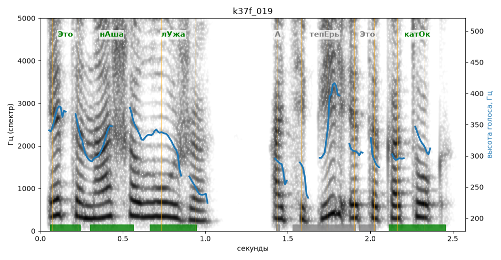

# k37f_019

Голос: **Филя, сборка 37f** · длительность 2.6 с
Эталон: Это наша лужа. А теперь это каток!
Распознано: Это наша лужа, а теперь это каток.
Слова: все совпали

## Ударения
(где нужно: ruaccent)

| слово | нужно | у голоса | |
|---|---|---|---|
| это | Это | Это | ✓ |
| наша | нАша | нАша | ✓ |
| лужа | лУжа | лУжа | ✓ |
| теперь | тепЕрь | — | ? |
| это | Это | этО | ? не разобрать |
| каток | катОк | катОк | ✓ |

## Интонация
- ✗ «это наша лужа.» — конец фразы не понижается — звучит незаконченно / как перечисление
- ✓ «а теперь это каток!» — выделено слово «теперь» (+4.8 пт)
- Диапазон голоса 8.1 полутонов (живо), средняя высота 312 Гц

## Паузы и темп
- паузы на своих местах
- Темп 7.3 слога/с (быстро)

_Синяя линия — высота голоса. Над словами заглавная буква — где ударение должно быть; красным — голос поставил не туда (уверенно), оранжевым — возможно._
