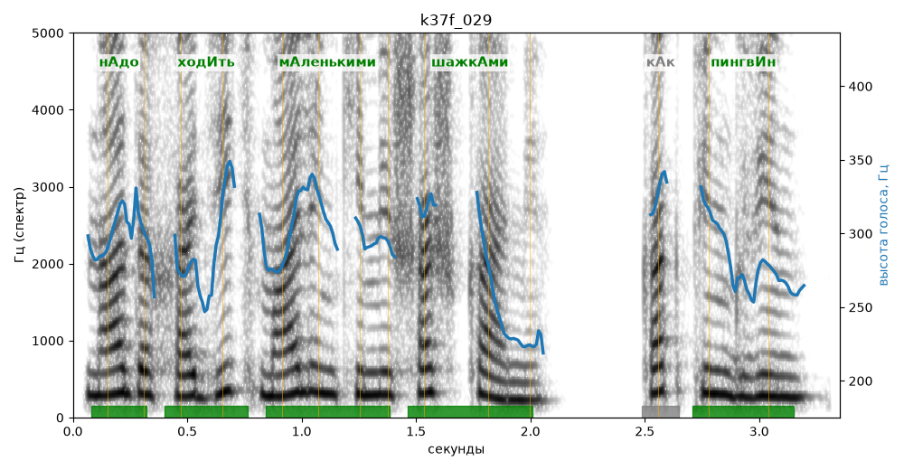

# k37f_029

Голос: **Филя, сборка 37f** · длительность 3.4 с
Эталон: Надо ходить маленькими шажками. Как пингвин!
Распознано: Надо ходить маленькими шашками. Как пингвин.
Расхождения в словах: «шажками» → «шашками»

## Ударения
(где нужно: ruaccent)

| слово | нужно | у голоса | |
|---|---|---|---|
| надо | нАдо | нАдо | ✓ |
| ходить | ходИть | ходИть | ✓ |
| маленькими | мАленькими | мАленькими | ✓ |
| шажками | шажкАми | шажкАми | ✓ |
| пингвин | пингвИн | пингвИн | ✓ |

## Интонация
- ✓ «надо ходить маленькими шажками.» — конец фразы понижается — звучит законченно
- ✗ «как пингвин!» — восклицание звучит ровно, без эмоции
- Диапазон голоса 6.6 полутонов (нормально), средняя высота 290 Гц

## Паузы и темп
- паузы на своих местах
- Темп 5.4 слога/с (нормально)

_Синяя линия — высота голоса. Над словами заглавная буква — где ударение должно быть; красным — голос поставил не туда (уверенно), оранжевым — возможно._
