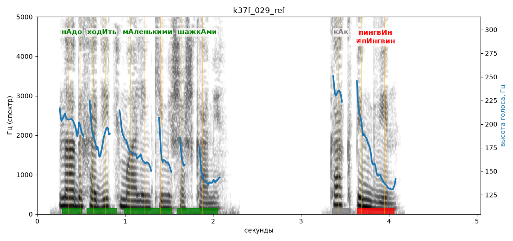

# k37f_029_ref

Голос: **edge:ru-RU-SvetlanaNeural** · длительность 5.0 с
Эталон: Надо ходить маленькими шажками. Как пингвин!
Распознано: Надо ходить маленькими шашками. Как пингвин?
Расхождения в словах: «шажками» → «шашками»

## Ударения
(где нужно: ruaccent)

| слово | нужно | у голоса | |
|---|---|---|---|
| надо | нАдо | нАдо | ✓ |
| ходить | ходИть | ходИть | ✓ |
| маленькими | мАленькими | мАленькими | ✓ |
| шажками | шажкАми | шажкАми | ✓ |
| пингвин | пингвИн | пИнгвин | ✗ ОШИБКА |

## Интонация
- ✓ «надо ходить маленькими шажками.» — конец фразы понижается — звучит законченно
- ✓ «как пингвин!» — выделено слово «как» (+3.8 пт)
- Диапазон голоса 9.2 полутонов (живо), средняя высота 170 Гц

## Паузы и темп
- паузы на своих местах
- Темп 5.7 слога/с (нормально)

_Синяя линия — высота голоса. Над словами заглавная буква — где ударение должно быть; красным — голос поставил не туда (уверенно), оранжевым — возможно._
