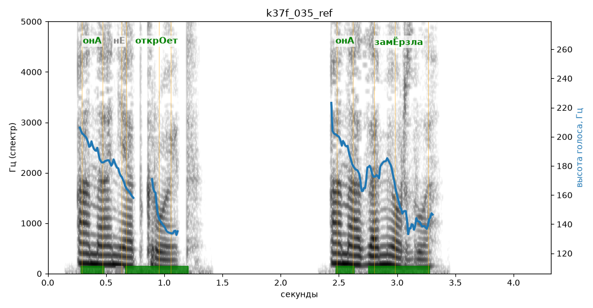

# k37f_035_ref

Голос: **edge:ru-RU-SvetlanaNeural** · длительность 4.3 с
Эталон: Она не откроет. Она замёрзла!
Распознано: Она не откроет. Она замерзла.
Слова: все совпали

## Ударения
(где нужно: ruaccent)

| слово | нужно | у голоса | |
|---|---|---|---|
| она | онА | онА | ✓ |
| откроет | открОет | открОет | ✓ |
| она | онА | онА | ✓ |
| замёрзла | замЁрзла | замЁрзла | ✓ |

## Интонация
- ✓ «она не откроет.» — конец фразы понижается — звучит законченно
- ✗ «она замёрзла!» — восклицание звучит ровно, без эмоции
- Диапазон голоса 6.9 полутонов (нормально), средняя высота 173 Гц

## Паузы и темп
- паузы на своих местах
- Темп 6.4 слога/с (нормально)

_Синяя линия — высота голоса. Над словами заглавная буква — где ударение должно быть; красным — голос поставил не туда (уверенно), оранжевым — возможно._
