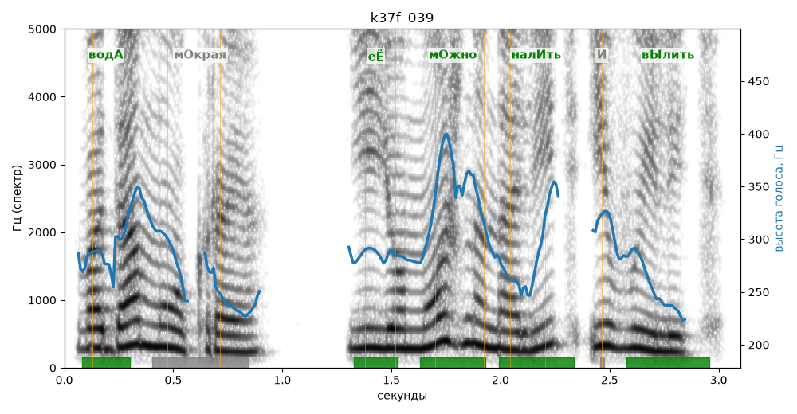

# k37f_039

Голос: **Филя, сборка 37f** · длительность 3.1 с
Эталон: Вода мокрая. Её можно налить и вылить.
Распознано: вода мокрая. Ее можно налить и вылить.
Слова: все совпали

## Ударения
(где нужно: ruaccent)

| слово | нужно | у голоса | |
|---|---|---|---|
| вода | водА | водА | ✓ |
| мокрая | мОкрая | — | ? |
| её | еЁ | еЁ | ✓ |
| можно | мОжно | мОжно | ✓ |
| налить | налИть | налИть | ✓ |
| вылить | вЫлить | вЫлить | ✓ |

## Интонация
- ✗ «вода мокрая.» — конец фразы не понижается — звучит незаконченно / как перечисление
- ✗ «её можно налить и вылить.» — конец фразы не понижается — звучит незаконченно / как перечисление
- Диапазон голоса 7.6 полутонов (живо), средняя высота 285 Гц

## Паузы и темп
- паузы на своих местах
- Темп 5.4 слога/с (нормально)

_Синяя линия — высота голоса. Над словами заглавная буква — где ударение должно быть; красным — голос поставил не туда (уверенно), оранжевым — возможно._
