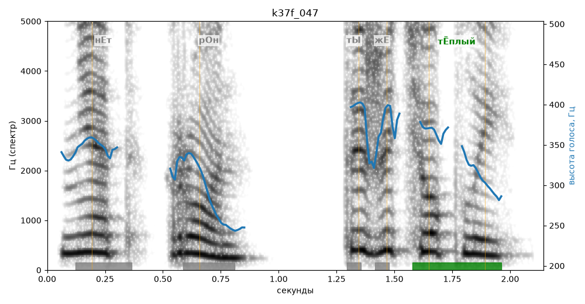

# k37f_047

Голос: **Филя, сборка 37f** · длительность 2.1 с
Эталон: Нет, Рон. Ты же тёплый!
Распознано: Нет, Рон, ты же теплый.
Слова: все совпали

## Ударения
(где нужно: дано в тексте)

| слово | нужно | у голоса | |
|---|---|---|---|
| тёплый | тЁплый | тЁплый | ✓ |

## Интонация
- ✗ «ты же тёплый!» — восклицание звучит ровно, без эмоции
- Диапазон голоса 8.2 полутонов (живо), средняя высота 336 Гц

## Паузы и темп
- паузы на своих местах
- Темп 5.3 слога/с (нормально)

_Синяя линия — высота голоса. Над словами заглавная буква — где ударение должно быть; красным — голос поставил не туда (уверенно), оранжевым — возможно._
