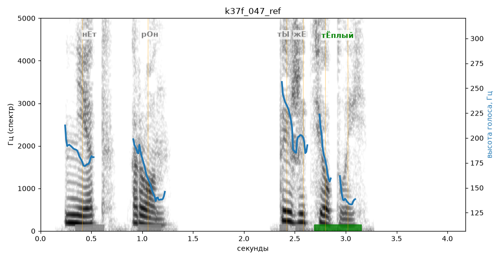

# k37f_047_ref

Голос: **edge:ru-RU-SvetlanaNeural** · длительность 4.2 с
Эталон: Нет, Рон. Ты же тёплый!
Распознано: Нет, Рон. Ты же теплый.
Слова: все совпали

## Ударения
(где нужно: дано в тексте)

| слово | нужно | у голоса | |
|---|---|---|---|
| тёплый | тЁплый | тЁплый | ✓ |

## Интонация
- ✓ «ты же тёплый!» — выделено слово «ты» (+3.5 пт)
- Диапазон голоса 9.1 полутонов (живо), средняя высота 181 Гц

## Паузы и темп
- паузы на своих местах
- Темп 4.6 слога/с (нормально)

_Синяя линия — высота голоса. Над словами заглавная буква — где ударение должно быть; красным — голос поставил не туда (уверенно), оранжевым — возможно._
