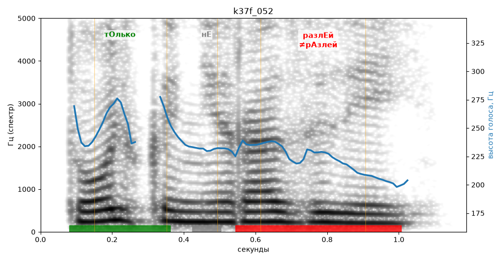

# k37f_052

Голос: **Филя, сборка 37f** · длительность 1.2 с
Эталон: Только не разлей.
Распознано: Только не разлей.
Слова: все совпали

## Ударения
(где нужно: ruaccent)

| слово | нужно | у голоса | |
|---|---|---|---|
| только | тОлько | тОлько | ✓ |
| разлей | разлЕй | рАзлей | ✗ ОШИБКА |

## Интонация
- ✓ «только не разлей.» — конец фразы понижается — звучит законченно
- Диапазон голоса 4.9 полутонов (нормально), средняя высота 232 Гц

## Паузы и темп
- паузы на своих местах
- Темп 5.4 слога/с (нормально)

_Синяя линия — высота голоса. Над словами заглавная буква — где ударение должно быть; красным — голос поставил не туда (уверенно), оранжевым — возможно._
