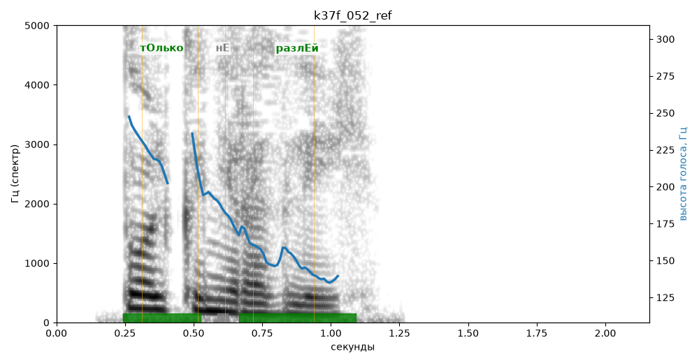

# k37f_052_ref

Голос: **edge:ru-RU-SvetlanaNeural** · длительность 2.2 с
Эталон: Только не разлей.
Распознано: Только не разлей.
Слова: все совпали

## Ударения
(где нужно: ruaccent)

| слово | нужно | у голоса | |
|---|---|---|---|
| только | тОлько | тОлько | ✓ |
| разлей | разлЕй | разлЕй | ✓ |

## Интонация
- ✓ «только не разлей.» — конец фразы понижается — звучит законченно
- Диапазон голоса 9.4 полутонов (живо), средняя высота 167 Гц

## Паузы и темп
- паузы на своих местах
- Темп 5.9 слога/с (нормально)

_Синяя линия — высота голоса. Над словами заглавная буква — где ударение должно быть; красным — голос поставил не туда (уверенно), оранжевым — возможно._
