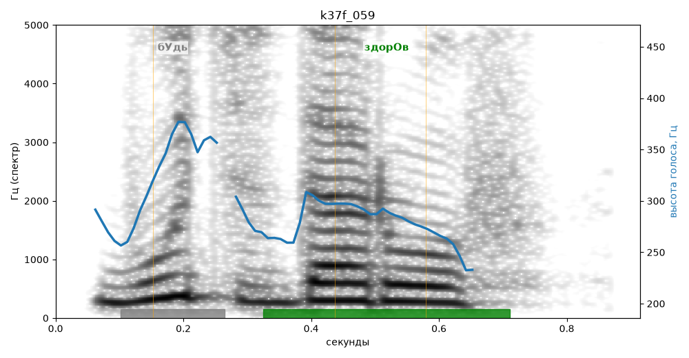

# k37f_059

Голос: **Филя, сборка 37f** · длительность 0.9 с
Эталон: Будь здоров!
Распознано: Будь здоров!
Слова: все совпали

## Ударения
(где нужно: ruaccent)

| слово | нужно | у голоса | |
|---|---|---|---|
| здоров | здорОв | здорОв | ✓ |

## Интонация
- ✓ «будь здоров!» — выделено слово «будь» (+2.6 пт)
- Диапазон голоса 6.2 полутонов (нормально), средняя высота 287 Гц

## Паузы и темп
- паузы на своих местах
- Темп 4.9 слога/с (нормально)

_Синяя линия — высота голоса. Над словами заглавная буква — где ударение должно быть; красным — голос поставил не туда (уверенно), оранжевым — возможно._
