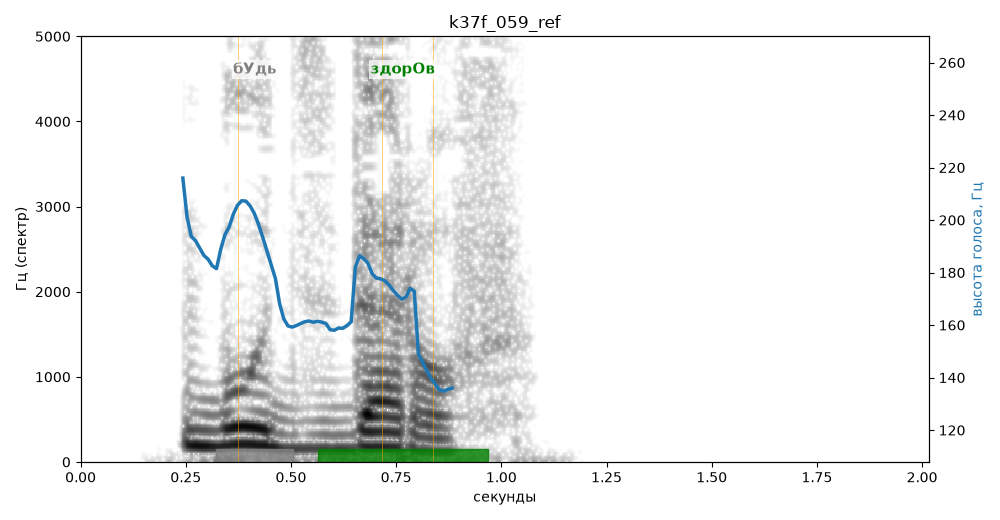

# k37f_059_ref

Голос: **edge:ru-RU-SvetlanaNeural** · длительность 2.0 с
Эталон: Будь здоров!
Распознано: Будь здоров!
Слова: все совпали

## Ударения
(где нужно: ruaccent)

| слово | нужно | у голоса | |
|---|---|---|---|
| здоров | здорОв | здорОв | ✓ |

## Интонация
- ✗ «будь здоров!» — восклицание звучит ровно, без эмоции
- Диапазон голоса 7.1 полутонов (живо), средняя высота 174 Гц

## Паузы и темп
- паузы на своих местах
- Темп 4.7 слога/с (нормально)

_Синяя линия — высота голоса. Над словами заглавная буква — где ударение должно быть; красным — голос поставил не туда (уверенно), оранжевым — возможно._
