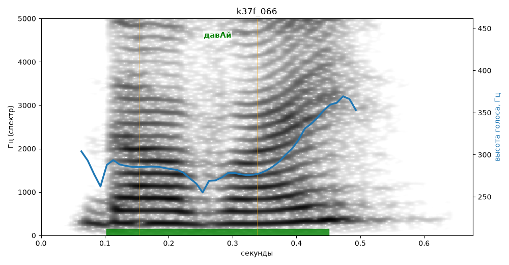

# k37f_066

Голос: **Филя, сборка 37f** · длительность 0.7 с
Эталон: Давай!
Распознано: Давай!
Слова: все совпали

## Ударения
(где нужно: ruaccent)

| слово | нужно | у голоса | |
|---|---|---|---|
| давай | давАй | давАй | ✓ |

## Интонация
- Диапазон голоса 5.3 полутонов (нормально), средняя высота 286 Гц

## Паузы и темп
- паузы на своих местах
- Темп 5.7 слога/с (нормально)

_Синяя линия — высота голоса. Над словами заглавная буква — где ударение должно быть; красным — голос поставил не туда (уверенно), оранжевым — возможно._
