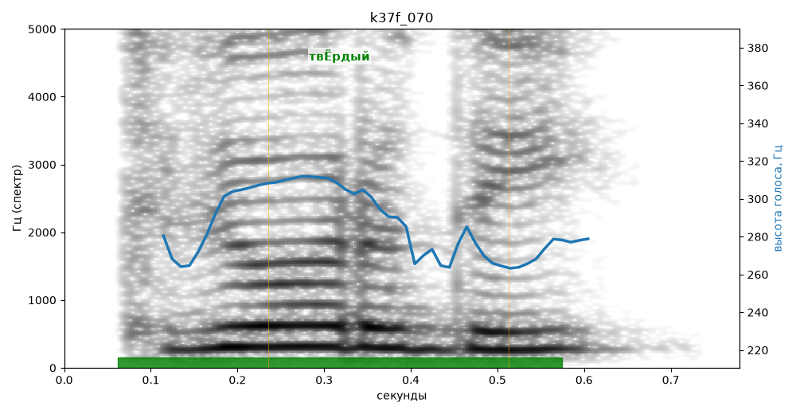

# k37f_070

Голос: **Филя, сборка 37f** · длительность 0.8 с
Эталон: Твёрдый!
Распознано: Тви Л responsible video
Расхождения в словах: «твердый» → «тви л»

## Ударения
(где нужно: дано в тексте)

| слово | нужно | у голоса | |
|---|---|---|---|
| твёрдый | твЁрдый | твЁрдый | ✓ |

## Интонация
- Диапазон голоса 2.9 полутонов (монотонно, как робот), средняя высота 281 Гц

## Паузы и темп
- паузы на своих местах
- Темп 3.9 слога/с (медленно)

_Синяя линия — высота голоса. Над словами заглавная буква — где ударение должно быть; красным — голос поставил не туда (уверенно), оранжевым — возможно._
