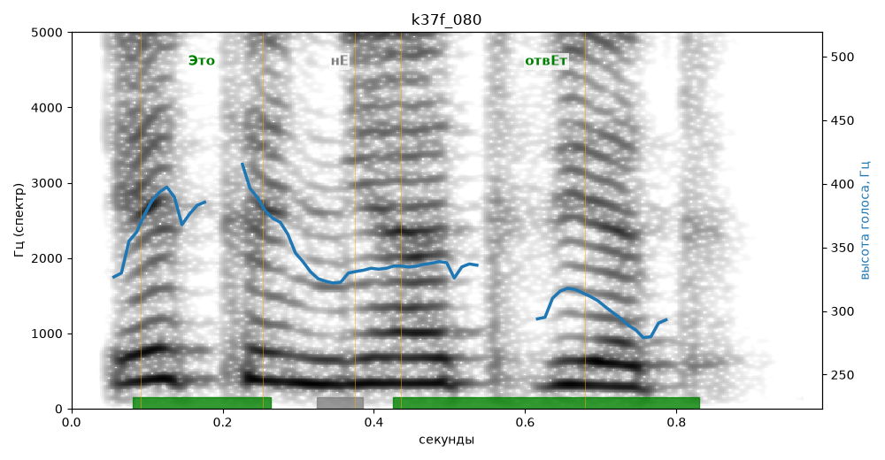

# k37f_080

Голос: **Филя, сборка 37f** · длительность 1.0 с
Эталон: Это не ответ!
Распознано: Это не ответ.
Слова: все совпали

## Ударения
(где нужно: ruaccent)

| слово | нужно | у голоса | |
|---|---|---|---|
| это | Это | Это | ✓ |
| ответ | отвЕт | отвЕт | ✓ |

## Интонация
- ✓ «это не ответ!» — выделено слово «это» (+2.0 пт)
- Диапазон голоса 5.3 полутонов (нормально), средняя высота 334 Гц

## Паузы и темп
- паузы на своих местах
- Темп 6.7 слога/с (быстро)

_Синяя линия — высота голоса. Над словами заглавная буква — где ударение должно быть; красным — голос поставил не туда (уверенно), оранжевым — возможно._
