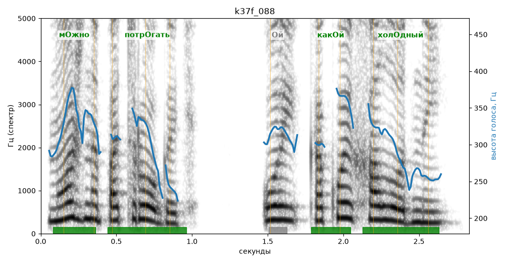

# k37f_088

Голос: **Филя, сборка 37f** · длительность 2.8 с
Эталон: Можно потрогать? Ой, какой холодный!
Распознано: Можно потрогать. Ой, какой холодный!
Слова: все совпали

## Ударения
(где нужно: ruaccent)

| слово | нужно | у голоса | |
|---|---|---|---|
| можно | мОжно | мОжно | ✓ |
| потрогать | потрОгать | потрОгать | ✓ |
| какой | какОй | какОй | ✓ |
| холодный | холОдный | холОдный | ✓ |

## Интонация
- ✗ «можно потрогать?» — нет вопросительного подъёма (самое высокое место — «можно», в начале) — звучит как утверждение
- ✓ «ой какой холодный!» — выделено слово «какой» (+2.9 пт)
- Диапазон голоса 7.2 полутонов (живо), средняя высота 309 Гц

## Паузы и темп
- паузы на своих местах
- Темп 6.0 слога/с (нормально)

_Синяя линия — высота голоса. Над словами заглавная буква — где ударение должно быть; красным — голос поставил не туда (уверенно), оранжевым — возможно._
