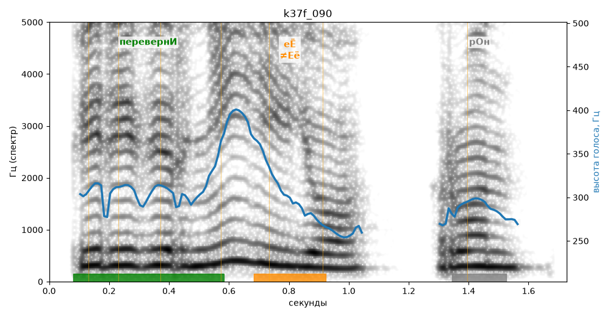

# k37f_090

Голос: **Филя, сборка 37f** · длительность 1.7 с
Эталон: Переверни её, Рон!
Распознано: переверни ее, крон.
Расхождения в словах: «рон» → «крон»

## Ударения
(где нужно: ruaccent)

| слово | нужно | у голоса | |
|---|---|---|---|
| переверни | перевернИ | перевернИ | ✓ |
| её | еЁ | Её | ✗? возможно — послушать |

## Интонация
- ✗ «переверни её рон!» — восклицание звучит ровно, без эмоции
- Диапазон голоса 6.9 полутонов (нормально), средняя высота 299 Гц

## Паузы и темп
- паузы на своих местах
- Темп 6.8 слога/с (быстро)

_Синяя линия — высота голоса. Над словами заглавная буква — где ударение должно быть; красным — голос поставил не туда (уверенно), оранжевым — возможно._
